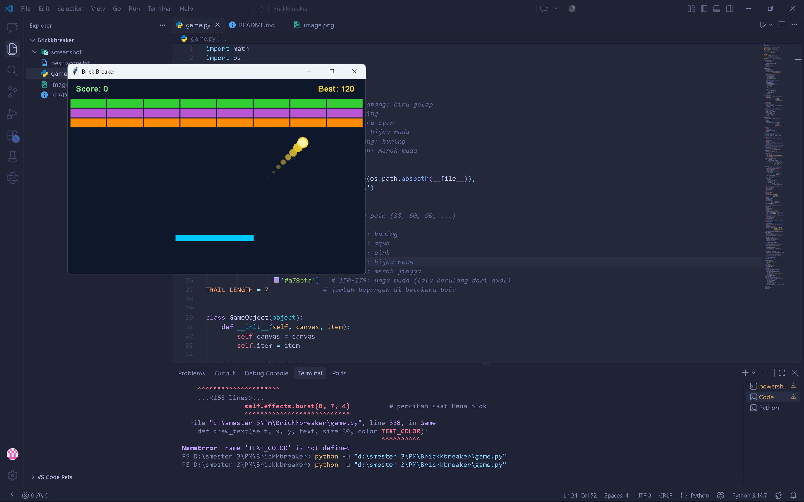
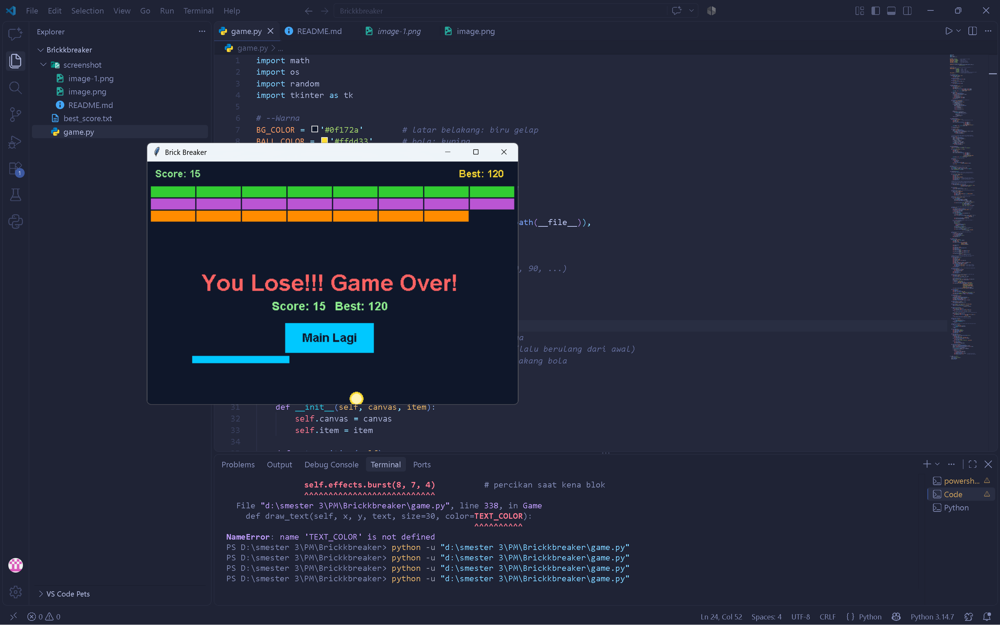
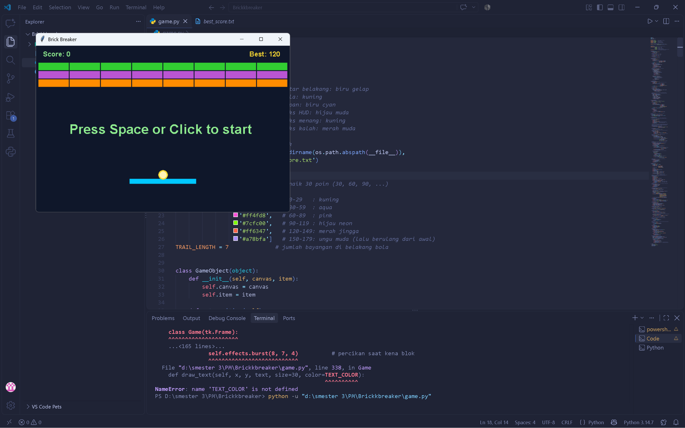

ketika game di jalankan bola akan muncul efeck shadow dan akan berganti warna setiap scor suah mencapai kelipatan 30.

Langsung kalah: begitu bola jatuh ke bawah (bolanya terlihat di tepi bawah jendela), game berhenti dan muncul “You Lose!!! Game Over!”. Sistem nyawa dihapus.
Teks merah muda: warnanya diganti dari hitam supaya kontras dengan latar biru gelap.
Ringkasan skor: tepat di bawahnya ada “Score: 15 Best: 120”, yaitu skor ronde ini dan rekor tertinggi. Kalau kamu memecahkan rekor, ada tambahan tulisan REKOR BARU! berwarna kuning.
Tombol “Main Lagi”: tombol cyan yang senada dengan papan. Kalau diklik, blok kembali penuh, skor jadi 0, dan game langsung jalan tanpa perlu menekan Spasi lagi.
Efek bersih: jejak dan percikan bola dihapus saat game berhenti, jadi layarnya tidak berantakan.
Rekor tersimpan: rekor otomatis ditulis ke best_score.txt setiap game berakhir, makanya angka 120 tetap ada walau game sudah ditutup dan dibuka lagi.
Layar menang: tampilannya sama, hanya tulisannya “You win!” berwarna kuning.

Tulisan mulai: dulu “Press Space to start” dengan font Forte ukuran besar. Sekarang “Press Space or Click to start”.
Latar belakang: yang awalnya biru muda, sekarang biru gelap.
Blok: awalnya merah dan biru. Sekarang tiga baris berwarna: hijau di atas (3x pukul), ungu di tengah (2x pukul), oranye di bawah (1x pukul).
Papan: lebih panjang (160) dan berwarna cyan, dulunya kuning dan pendek.
Bola: diam di atas papan dengan inti kuning pucat dan tepi kuning, sebelumnya bola putih polos.
Bagian atas layar:
Kiri atas: “Score: 0”, baru ditambahkan.
Kanan atas: “Best: 120”, rekor tertinggi yang tersimpan.
Tulisan “Lives” hilang karena sistem nyawa dihapus.